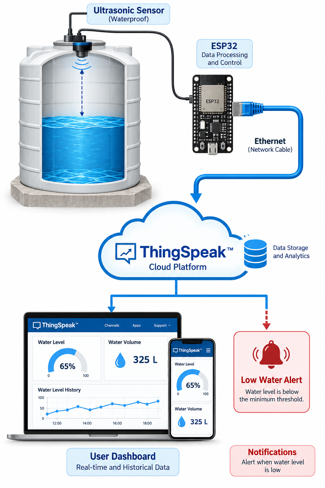
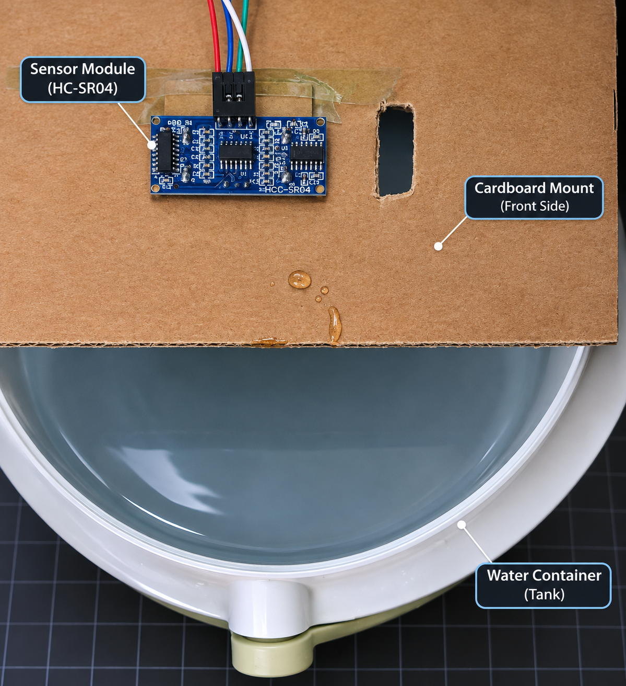
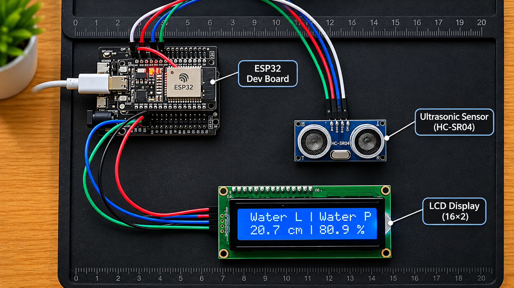
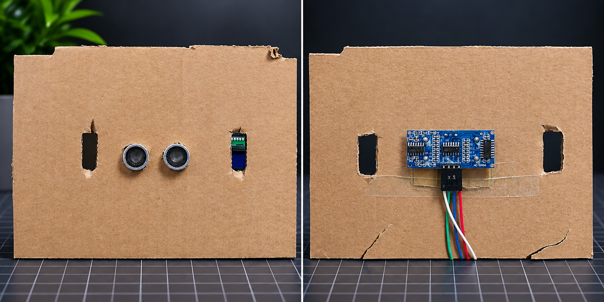
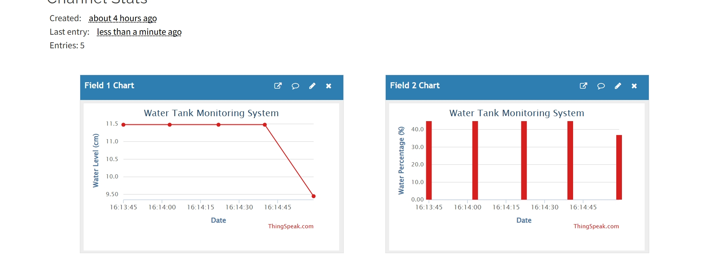
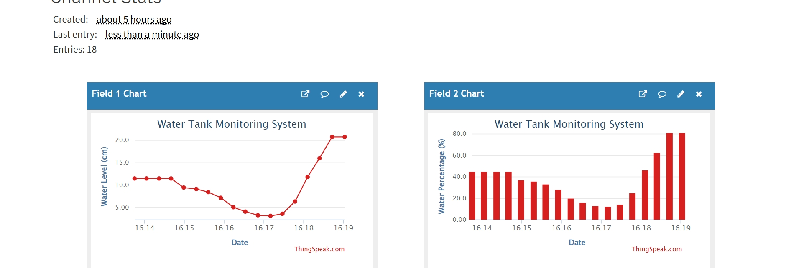
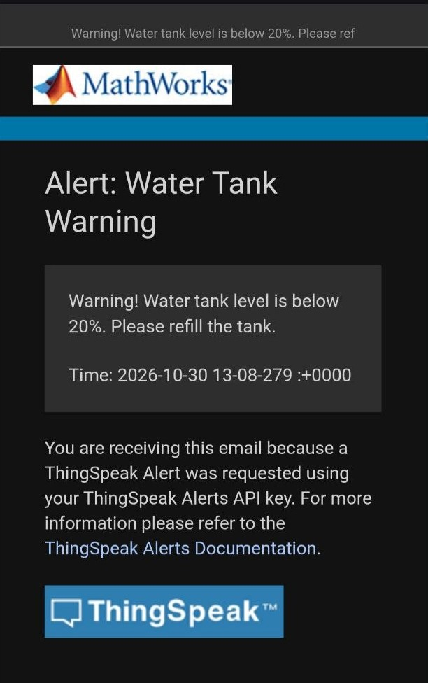

# IoT Water Tank Monitoring System

An IoT-based water tank monitoring system designed to measure water level and monitor tank capacity using an ESP32 microcontroller and an ultrasonic sensor. The system processes sensor readings, calculates the water level and fill percentage, and transmits measurements to ThingSpeak Cloud for remote monitoring and visualization.

---

## Project Overview

The system measures the distance between the ultrasonic sensor and the water surface. The ESP32 processes these measurements to calculate the current water height and the tank fill percentage.

The collected data is transmitted through Wi-Fi to ThingSpeak, where it is stored and visualized using interactive charts. The system also supports low-water email notifications.



## Hardware Components

The project consists of the following components:

| Component | Description |
|---|---|
| ESP32 DevKit V1 | Main microcontroller for sensor processing and cloud communication |
| HC-SR04 Ultrasonic Sensor | Measures the distance to the water surface |
| 16x2 I2C LCD | Displays water level and fill percentage |
| RGB LED | Provides visual status indication |
| Water Container | Represents the monitored water tank |

## Hardware Implementation

The ultrasonic sensor is mounted above the water container to measure the distance between the sensor and the water surface.



### Hardware Components and Connections

The ESP32 receives measurements from the ultrasonic sensor and displays the calculated values on the LCD.



### Sensor Panel Assembly

The following images show the front and rear sides of the sensor mounting panel.



## System Architecture and Data Flow

The system follows this workflow:

1. The ultrasonic sensor measures the distance to the water surface.
2. The ESP32 receives and processes the sensor readings.
3. The current water height and fill percentage are calculated.
4. The ESP32 transmits measurements to ThingSpeak using Wi-Fi.
5. ThingSpeak stores and visualizes the collected data.
6. The cloud-based alert mechanism can notify the user when the water level falls below the configured threshold.

```text
Ultrasonic Sensor
       |
       v
     ESP32
       |
       v
  Wi-Fi Network
       |
       v
 ThingSpeak Cloud
       |
       +------> Data Visualization
       |
       +------> Email Notifications
```

## Cloud Integration - ThingSpeak

ThingSpeak is used as the cloud platform for collecting, storing, and visualizing sensor measurements.

The system currently uses the following channel fields:

| Field | Description | Unit |
|---|---|---|
| Field 1 | Water Level | cm |
| Field 2 | Water Percentage | % |
| Field 3 | Water Volume | L (Reserved for future implementation) |

### Water Level Monitoring

The following chart illustrates the recorded water level measurements over time.



### Water Percentage Monitoring

This chart displays the calculated water fill percentage and its changes over time.



## Email Notifications

The system uses ThingSpeak Alerts API together with MATLAB Analysis and React to generate an email notification when the water percentage falls below the configured threshold of 20%.



## Software and Technologies

- C++
- Arduino Framework
- ESP32
- PlatformIO
- Wi-Fi
- HTTP Communication
- ThingSpeak IoT Cloud
- MATLAB Analysis
- ThingSpeak React
- LiquidCrystal_I2C Library

## Key Features

- Ultrasonic water level measurement.
- Automatic tank height calibration.
- Water height calculation in centimeters.
- Water fill percentage calculation.
- LCD-based local monitoring.
- Wi-Fi connectivity.
- Cloud data transmission.
- Historical data visualization.
- Low-water email notifications.

## Future Improvements

- Water volume calculation and cloud integration.
- Custom web-based monitoring dashboard.
- Improved sensor filtering and measurement reliability.
- Advanced water consumption analysis.
- Automatic water pump control.

## Security

Wi-Fi credentials and ThingSpeak API keys are stored in a local `secrets.h` file, which is excluded from version control using `.gitignore`.

Users must create their own `include/secrets.h` file and configure their credentials before running the project.

Never commit private credentials or API keys to a public repository.

## Author

Developed as an Internet of Things (IoT) project.

**Technologies:** ESP32 | C++ | PlatformIO | ThingSpeak
